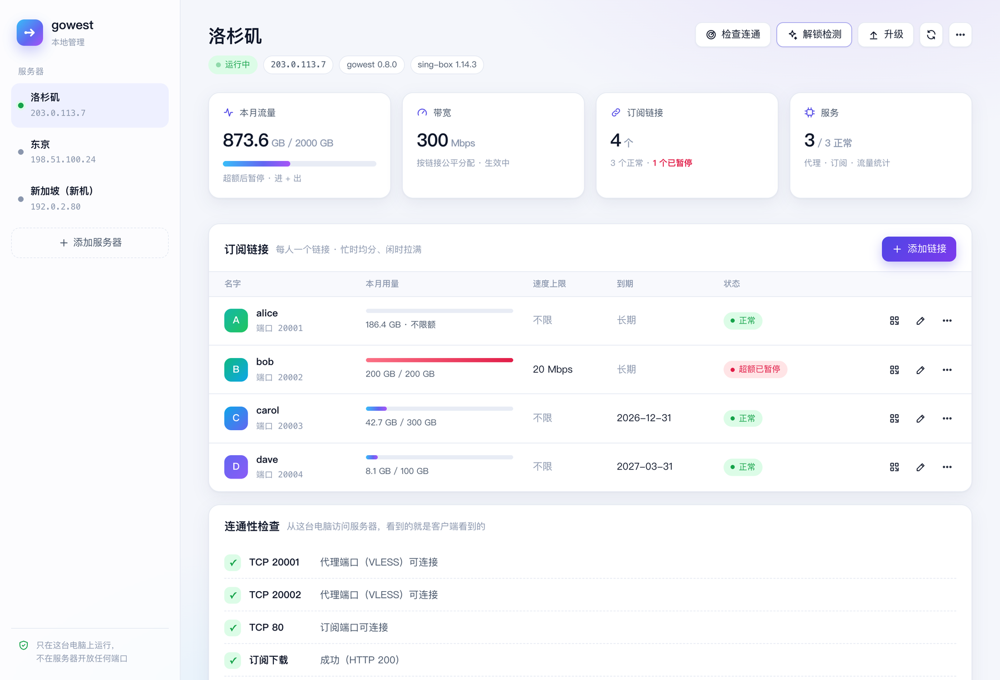
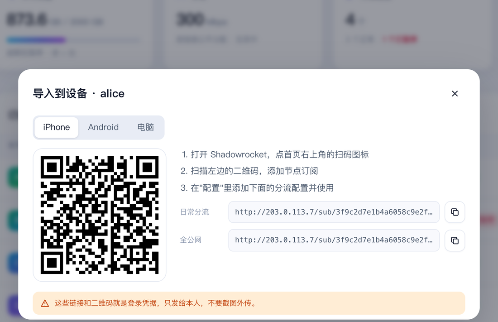

<p align="center">
  
</p>

<p align="center">
  
  
  
  
  
</p>

<p align="center">
  <a href="#-快速开始">快速开始</a> ·
  <a href="#-网页管理">网页管理</a> ·
  <a href="#-效果预览">效果预览</a> ·
  <a href="#-多人共用与流量配额">多人共用</a> ·
  <a href="#-客户端下载">客户端下载</a> ·
  <a href="docs/详细说明.md">详细说明</a> ·
  <a href="CHANGELOG.md">更新日志</a>
</p>

---

**gowest** 适合**几个人合租一台海外服务器**：在空白的 Ubuntu 24.04 上，用一条命令部署 **Hysteria2 + VLESS REALITY** 双协议代理，每人一个订阅链接，带宽公平分配，按月控制流量，四端订阅都已配好 AI / Claude 分流。一个人用也完全可以。

- **一条命令或一个网页**：在自己电脑上运行，零问答安装；失败自动回滚；也可以在本地网页里点几下完成安装和日常管理。
- **双线路互备**：Hy2 优先，故障时自动切到 VLESS，不会悄悄走直连。
- **多人共用**：每人一个订阅链接；忙时均分，闲时拉满；随时加人、删人、换链接，其他人不受影响。
- **按人管流量**：每个链接可以单独设速度上限、月流量额度和到期日，超了只停那一个人。
- **解锁检测**：一条命令看这台服务器能不能用 Claude、ChatGPT、TikTok、YouTube。

## 🚀 快速开始

**1. 准备服务器**：空白 Ubuntu 24.04，在云控制台的安全组放行 **TCP/UDP 443** 和 **TCP 80**。多人共用时改为放行 **TCP/UDP 20001-20032** 和 **TCP 80**，以后加人就不用再改安全组。

**2. 在你自己的电脑上运行**（通过 SSH 把代码传到服务器，服务器上不需要 git）：

```sh
git clone https://github.com/lileilei2023/gowest.git && cd gowest
./remote.sh root@<服务器IP> quick 100Mbps              # 零问答，一个人用
./remote.sh root@<服务器IP> quick 100Mbps --users 3    # 三个人共用
```

`quick` 自动识别 IP、用默认设置直接安装，装完从你电脑上检查端口通不通，并在终端显示手机扫码导入的二维码。想逐项确认设置，就不加 `quick`，运行中文向导。

**3. 导入客户端**：随时可以查看订阅地址和二维码：

```sh
./remote.sh root@<服务器IP> urls --client mac          # 或 windows / android / shadowrocket
./remote.sh root@<服务器IP> urls --client all --qr     # 手机扫码导入
./remote.sh root@<服务器IP> check                      # 从这台电脑检查端口和订阅是否通
```

**以后升级**：拉取最新代码后一条命令，密钥、端口和订阅地址都不变，客户端无需重新导入：

```sh
git pull && ./remote.sh root@<服务器IP> upgrade
```

更喜欢点按钮的话，见下面的 [网页管理](#-网页管理)。Windows 电脑没有 `sh` 时，可以用网页管理，或者 SSH 登录服务器后在服务器上 `git clone`，再运行 `sudo bash deploy.sh`（升级用 `sudo bash deploy.sh upgrade --confirm-server <服务器IP>`）。

客户端去哪下载，见 [客户端下载](#-客户端下载)。更多方式（非交互安装、本机预览配置、安全组模板）见 [快速部署](docs/快速部署.md)。

## 🖥 网页管理

```sh
./remote.sh ui          # Windows：python gowest_ui.py
```

会在你自己的电脑上打开一个管理页面：

- 添加多台服务器，查看运行状态、本月流量和每个人的用量；
- 在空白服务器上一键安装，实时显示安装进度；
- 加人、删人、重置链接，设置速度上限、流量额度和到期日；
- 显示二维码，手机对着屏幕扫一下就能导入；
- 一键检查端口连通、解锁检测和升级。

<p align="center"></p>
<p align="center"></p>

**它和 3x-ui、Marzban 这类面板的区别**：那些面板运行在服务器上，要对公网开一个管理端口。gowest 的页面只运行在你的电脑上，所有操作都通过你自己的 SSH 密钥执行，服务器上不开任何新端口，也不常驻面板程序。页面只接受本机访问，地址里带一次性令牌，关掉终端就停止。

前提是能用 SSH 密钥登录服务器（大多数云服务器默认就是），并且登录用户是 root 或者可以免密码 sudo。服务器列表保存在 `~/.gowest/servers.json`，只有你自己能读。截图中的数据为示意。

## 📸 效果预览

**部署向导**：一个人用时，"共用份数"和"流量上限"直接回车即可。

<p align="center"></p>

**桌面客户端**：两份订阅（日常分流 / 全公网），统一的 `AI / Claude / YouTube / TikTok` 代理组。

<p align="center"></p>

**手机客户端**：Android 点链接一键导入；iOS 用 Shadowrocket。

<p align="center"></p>

## 👥 多人共用与流量配额

向导里的"共用份数"填 `3` 或 `alice,bob,carol`，就会生成 3 个订阅链接，分给 3 个人：

- 每个链接有独立的密钥和端口，泄露了只影响那一份；
- 带宽按链接分配：一个人用时拉满，几个人同时用时均分，开多少连接都抢不走别人的份额；
- 每个链接可以单独设速度上限、月流量额度和到期日，超额或到期只停那一个人，其他人不受影响。

下图是真实内核上的实测结果（总速率 95 Mbps）：

<p align="center"></p>

装好之后随时管理，立即生效，其他人的订阅地址不变：

```sh
./remote.sh root@<服务器IP> users                                    # 每个人的端口、上限、本月用量、到期日、状态
./remote.sh root@<服务器IP> users add dave --quota 100 --expire 2026-12-31
./remote.sh root@<服务器IP> users set bob --cap 20Mbps --quota 200    # 速度上限、月流量额度
./remote.sh root@<服务器IP> users reset bob                          # 链接泄露了：只换他一个人的
./remote.sh root@<服务器IP> users remove bob
./remote.sh root@<服务器IP> bandwidth --set 200Mbps                  # 整台服务器的带宽
./remote.sh root@<服务器IP> traffic --quota 1TB --on-exceed stop     # 整台服务器的月流量
```

- 每人的用量按他自己的上传加下载统计，订阅里显示的是他自己的用量和额度。整台服务器的用量另外统计，大约是所有人用量之和的两倍，因为服务器收发各算一次，云厂商一般按这个计费。
- 额度和到期日用 `0` 或 `none` 取消。超额的人下个月自动恢复；调高额度后几分钟内恢复。
- 只写数字时，流量按 GB、带宽按 Mbps 计算。实现原理见 [详细说明](docs/详细说明.md)。

## 🧭 Claude / TikTok 能不能用

```sh
./remote.sh root@<服务器IP> unlock
```

在服务器上检测出口 IP 的国家和运营商，以及 Claude、ChatGPT、TikTok、YouTube 能否正常使用。所有客户端都从这个 IP 出去，所以结果对每个人都一样。建议买服务器后先测一下再装。检测依据是各网站公开的返回特征，网站调整后可能失准。

## 📥 客户端下载

Mac / Windows 也可以直接运行 `clients/` 里的一键脚本，自动下载、校验并导入订阅。

| 平台 | 客户端 | 官方下载 |
| --- | --- | --- |
| macOS | Clash Verge Rev 2.5.8 | [Apple 芯片](https://github.com/clash-verge-rev/clash-verge-rev/releases/download/v2.5.8/Clash.Verge_2.5.8_aarch64.dmg) · [Intel](https://github.com/clash-verge-rev/clash-verge-rev/releases/download/v2.5.8/Clash.Verge_2.5.8_x64.dmg) |
| Windows | Clash Verge Rev 2.5.8 | [x64](https://github.com/clash-verge-rev/clash-verge-rev/releases/download/v2.5.8/Clash.Verge_2.5.8_x64-setup.exe) · [ARM64](https://github.com/clash-verge-rev/clash-verge-rev/releases/download/v2.5.8/Clash.Verge_2.5.8_arm64-setup.exe) |
| Android | Clash Meta for Android | [GitHub Releases](https://github.com/MetaCubeX/ClashMetaForAndroid/releases/latest)（一般选 `arm64-v8a`，不确定选 `universal`） |
| iOS | Shadowrocket（付费） | [App Store](https://apps.apple.com/us/app/shadowrocket/id932747118)（需非中国大陆区 Apple ID），见 [小火箭使用指南](docs/小火箭使用指南.md) |

> [!WARNING]
> Clash for Windows、ClashX 和旧版 Clash for Android 不支持这两种协议，无法使用。请只从上面的官方地址下载。

## 🎯 使用场景

两份订阅加上客户端开关，可以组合出四种常用用法（详见 [桌面使用指南](docs/桌面使用指南.md)）：

<p align="center"></p>

## 🏗 架构

<p align="center"></p>

<details>
<summary><b>常用运维命令</b></summary>

```sh
./remote.sh root@<服务器IP> status     # 版本、运行状态、队列、本月流量、各链接用量
./remote.sh root@<服务器IP> verify     # 本机验收
./remote.sh root@<服务器IP> rollback   # 回滚（可恢复）
```

在服务器上直接操作时，把 `./remote.sh root@<服务器IP>` 换成 `sudo bash /opt/la-vpn/deploy.sh`；改带宽、流量和升级还要加 `--confirm-server <服务器IP>`。

</details>

<details>
<summary><b>开发与测试</b></summary>

```text
gowest/
├── remote.sh                 # 在自己电脑上运行：上传、安装、升级、管理
├── gowest_ui.py, ui/         # 本地网页管理（只在自己电脑上运行，经 SSH 操作服务器）
├── localcheck.py             # 从自己电脑检查端口和订阅是否通
├── deploy.sh / launcher.py   # 中文向导与统一入口
├── vpn.py                    # plan / install / upgrade / status / verify / urls / users / unlock / bandwidth / traffic / rollback
├── accounting.py             # 每个链接的流量计数、超额或到期暂停（nftables）
├── unlock.py                 # Claude / ChatGPT / TikTok / YouTube 解锁检测
├── render.py                 # 密钥、端口、Clash YAML、小火箭配置
├── network.py                # BBR / FQ 与按链接分配的 HTB 队列
├── subinfo.py                # 月流量统计、超额暂停与恢复
├── hostfirewall.py           # UFW 规则（可回滚）
├── firewall.py, firewall/    # 云安全组模板
├── check.py / probe.py       # 离线一致性检查；客户端测速
├── clients/                  # Mac / Windows 一键脚本
├── native/, build_native.py  # Nuitka 原生编译
├── tests/                    # 离线测试与隔离集成测试
└── docs/                     # 详细说明与使用指南
```

```sh
python3 -B -m unittest discover -s tests -v
```

已验证和未验证的范围见 [更新日志 · 验证现状](CHANGELOG.md#验证现状)。

</details>

## ⚠️ 须知

- 只支持**全新服务器**，检测到已有代理或网站时会拒绝安装。
- HTTP 订阅会明文传输凭据，安装时需要确认；不要把订阅地址贴到公开的地方。
- 云安全组需要你自己放行，工具无法替你验证公网是否可达。
- 每个链接的用量按端口统计，服务器重启后的头一两分钟不计入。整台服务器的流量上限和暂停作用于所有人。
- 一个人用的安装（端口 443）不能事后加人；要多人共用请在安装时就选 2 份或以上。
- 本仓库不含任何节点的密钥或订阅。顶部动画和界面截图为示意图，IP、延迟等数值仅作演示；带宽实测图是真实数据。

本项目仅供学习与研究网络技术使用，请遵守当地法律法规和服务条款。
