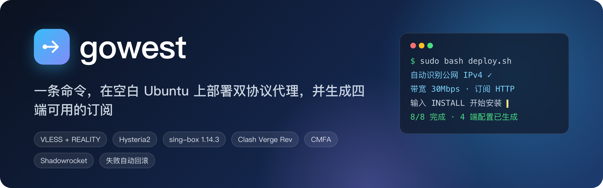

<p align="center">
  
</p>

<p align="center">
  
  
  
  
  
  
</p>

<p align="center">
  <a href="#-快速开始">快速开始</a> ·
  <a href="#-效果预览">效果预览</a> ·
  <a href="#-架构">架构</a> ·
  <a href="#-客户端下载与导入">客户端下载</a> ·
  <a href="#-使用场景">使用场景</a> ·
  <a href="docs/详细说明.md">详细说明</a> ·
  <a href="docs/快速部署.md">快速部署</a> ·
  <a href="CHANGELOG.md">更新日志</a>
</p>

---

**gowest** 是一个面向个人自建场景的代理部署工具。在一台**空白的 Ubuntu 24.04** 服务器上运行一次中文向导，它会：

- 安装经过 SHA-256 校验的 **sing-box**，同机提供 **Hysteria2（UDP 443）** 与 **VLESS + REALITY（TCP 443）** 两条线路；
- 为每台新服务器生成独立的密钥、证书和随机订阅令牌；
- 一次生成 **macOS / Windows / Android / iOS** 四端可用的订阅，并带好统一的分流代理组；
- 全程可回滚：冲突检测、安装保护定时器、失败自动回滚、改动指纹校验。

> [!NOTE]
> 本仓库是**通用复建源码**，不包含任何现有节点的密钥或订阅。下文截图均为**界面示意图**：组名、节点名、向导提示和安装阶段与代码真实输出一致，IP、延迟、速度等数值仅为演示。

## ✨ 特性

| | 功能 | 说明 |
| --- | --- | --- |
| 🚀 | **一条命令部署** | `sudo bash deploy.sh`：自动识别公网 IPv4，带宽只填一次（`30Mbps` / `1Gbps`），输入 `INSTALL` 才开始 |
| 🔀 | **同机双协议 + 自动回退** | Hy2 优先，健康检查失败时切到 VLESS；不会悄悄回落到直连 |
| 📱 | **四端订阅一次生成** | Clash Verge Rev、Clash Meta for Android 一键导入链接；Shadowrocket 原生节点 + 两份 `.conf` |
| 🧭 | **统一代理组** | `出口选择 / 自动回退 / AI / Claude / YouTube / TikTok`，多台服务器只靠节点前缀（LA、DC…）区分 |
| 🛡️ | **事务式安装** | 只接受全新服务器；30 分钟保护定时器、失败回滚、可恢复归档，SSH 断线不影响安装 |
| ⚡ | **保守的网络优化** | BBR、只替换默认队列的安全 FQ、4/32 MiB 缓冲、TCP MTU 探测 |
| 🔥 | **防火墙辅助** | 安全新增 UFW 规则（不动 SSH、不清空规则）；提供 HTTP/HTTPS 两份云安全组模板 |
| 🧪 | **可验证** | 离线配置检查、真实内核语法校验、回环协议测试、客户端出口 / STUN / 小流量测速工具 |

## 📸 效果预览

### 部署向导

在新服务器上运行向导，填写 3～4 项即可完成安装，8 个阶段都会显示耗时：

<p align="center"></p>

### 桌面客户端（Clash Verge Rev / mihomo）

导入后会看到两份订阅（日常分流 / 全公网）和一组统一的代理组。`Claude → AI → 自动回退 → DC-Hy2 / DC-VLESS`：

<p align="center"></p>

### 手机客户端

Android 在浏览器中点 `clashmeta://` 链接即可导入；iOS 使用 Shadowrocket 的节点订阅加分流配置：

<p align="center"></p>

## 🏗 架构

<p align="center"></p>

- 两种协议共用**同一台**服务器并直接出站。自动回退能应对单个协议故障，但不能应对整台服务器宕机。
- 自动回退是**故障切换**，不是挑最低延迟。BBR 主要影响 TCP（VLESS），Hy2 使用自己的 QUIC 拥塞控制。

## 🚀 快速开始

**准备：** 空白 Ubuntu 24.04（amd64/arm64）、systemd、≥ 512 MiB 内存、公网 IPv4。在云安全组放行 SSH、**TCP 443**、**UDP 443** 和订阅端口（HTTP 80 / HTTPS 8443）。

```sh
# 1. 把项目上传到新服务器
git clone https://github.com/lileilei2023/gowest.git && cd gowest

# 2. 运行向导（建议在 tmux 中运行）
sudo bash deploy.sh

# 3. 查看各客户端的导入方式
sudo bash /opt/la-vpn/deploy.sh urls --client mac        # 或 windows / android / shadowrocket
```

<details>
<summary><b>非交互用法 / 在本机预览配置</b></summary>

```sh
# 只生成参数文件，不安装
bash deploy.sh init --server-ip <新服务器IP> --node-prefix DC --bandwidth 30Mbps \
  --accept-http-risk --output settings.local.json

# 查看计划，不联网、不做改动
bash deploy.sh plan --settings settings.local.json

# 在本地离线生成一套配置并检查（需要 Python 3.10+、OpenSSL、PyYAML）
python3 -B render.py --settings settings.local.json --output generated-review
python3 -B check.py --generated generated-review

# 在新服务器上安装
sudo bash deploy.sh install --settings settings.local.json --confirm-new-server <新服务器IP>
```

</details>

<details>
<summary><b>运维命令</b></summary>

```sh
sudo python3 -B /opt/la-vpn/vpn.py status     # 状态、BBR/FQ 实际生效情况
sudo python3 -B /opt/la-vpn/vpn.py verify     # 本机验收
sudo python3 -B /opt/la-vpn/vpn.py rollback   # 回滚（归档到 /var/lib/la-vpn-archives，可恢复）

# 客户端侧测速 / 出口核对
python3 -B probe.py --proxy http://127.0.0.1:7897 --expect-exit-ip <新服务器IP> --download-mib 8 --rounds 3
```

</details>

## 📥 客户端下载与导入

Mac / Windows 用户可以直接运行 `clients/` 里的一键脚本：脚本会下载下表中的同一版本，校验 SHA-256，然后导入订阅。想手动安装时，从下表的官方地址下载：

| 平台 | 客户端 | 下载（官方来源） | 导入方式 |
| --- | --- | --- | --- |
| macOS（Apple 芯片） | Clash Verge Rev 2.5.8 | [Clash.Verge_2.5.8_aarch64.dmg](https://github.com/clash-verge-rev/clash-verge-rev/releases/download/v2.5.8/Clash.Verge_2.5.8_aarch64.dmg) | 一键脚本 `clients/macos/gowest-client.command`，或打开 `urls --client mac` 输出的 `clash://` 链接 |
| macOS（Intel） | Clash Verge Rev 2.5.8 | [Clash.Verge_2.5.8_x64.dmg](https://github.com/clash-verge-rev/clash-verge-rev/releases/download/v2.5.8/Clash.Verge_2.5.8_x64.dmg) | 同上 |
| Windows（x64） | Clash Verge Rev 2.5.8 | [Clash.Verge_2.5.8_x64-setup.exe](https://github.com/clash-verge-rev/clash-verge-rev/releases/download/v2.5.8/Clash.Verge_2.5.8_x64-setup.exe) | 一键脚本 `clients/windows/gowest-client.cmd`，或 `urls --client windows` 输出的 `clash://` 链接 |
| Windows（ARM64） | Clash Verge Rev 2.5.8 | [Clash.Verge_2.5.8_arm64-setup.exe](https://github.com/clash-verge-rev/clash-verge-rev/releases/download/v2.5.8/Clash.Verge_2.5.8_arm64-setup.exe) | 同上 |
| Android | Clash Meta for Android | [GitHub Releases](https://github.com/MetaCubeX/ClashMetaForAndroid/releases/latest)：大多数手机选 `cmfa-*-meta-arm64-v8a-release.apk`，不确定时选 `universal` | 在手机浏览器中打开 `urls --client android` 输出的 `clashmeta://` 链接 |
| iOS | Shadowrocket（付费） | [App Store](https://apps.apple.com/us/app/shadowrocket/id932747118)（中国大陆区未上架，需要使用其他地区的 Apple ID） | 节点订阅 `-nodes`，加上 `-shadowrocket.conf` 或 `-us-shadowrocket.conf`，见 [小火箭使用指南](docs/小火箭使用指南.md) |

其他版本见 [Clash Verge Rev Releases](https://github.com/clash-verge-rev/clash-verge-rev/releases)。一键脚本锁定的是 2.5.8；如果你手动装了更新的版本，脚本会把它视为已安装，不会降级。

> [!WARNING]
> Clash for Windows、ClashX 和旧版 Clash for Android 的内核不支持 VLESS+REALITY 和 Hysteria2，无法使用。请只从上面的官方来源下载，不要用来路不明的"破解版"或镜像站安装包。

## 🎯 使用场景

两份订阅加上客户端开关，可以组合出四种常用场景（详见 [桌面使用指南](docs/桌面使用指南.md)）：

<p align="center"></p>

## 📂 项目结构

```text
gowest/
├── deploy.sh / launcher.py   # 中文向导与统一入口
├── vpn.py                    # plan / install / status / verify / urls / rollback
├── render.py                 # 生成独立密钥、Clash YAML、小火箭配置
├── network.py                # BBR / FQ / 缓冲：快照、优化、恢复
├── hostfirewall.py           # 保守新增 UFW 规则并支持回滚
├── firewall.py, firewall/    # 云安全组模板的生成与校验
├── check.py / probe.py       # 离线一致性检查；客户端出口与测速
├── clients/                  # Mac / Windows 一键安装与导入脚本
├── native/, build_native.py  # Nuitka 原生编译（交付时不带源码）
├── tests/                    # 186 个离线测试，以及 netns / 回环集成测试
└── docs/                     # 详细说明、快速部署、桌面 / 小火箭使用指南、原生编译
```

## 🧪 测试

```sh
python3 -B -m unittest discover -s tests -v
```

测试全部在离线或隔离环境中运行，不使用任何生产节点凭据。已验证与未验证的范围见 [更新日志 · 验证现状](CHANGELOG.md#验证现状)。

## ⚠️ 边界与安全

- **只支持全新服务器**：检测到已有 sing-box、代理或网站时会拒绝安装，也没有 `--force` 选项。
- **HTTP 订阅会明文传输凭据**，因此必须显式确认；HTTPS 需要自备可信证书（本版不自动申请或续期）。
- **云安全组无法自动验证**：本机能监听，不代表公网已经能访问。
- 没有系统级 kill switch，也不承诺零泄漏、住宅 IP 或某个服务一定不会触发风控。
- 不要把带令牌的订阅地址贴到公开日志、仓库或在线订阅转换网站。

更多细节（参数说明、DNS/TUN 规则、FQ 策略、回滚语义）见 **[详细说明](docs/详细说明.md)**；各版本的改动见 [CHANGELOG](CHANGELOG.md)。

## 📜 免责声明

本项目仅供学习与研究网络技术使用。请遵守你所在地区的法律法规，以及云服务商和各网站的服务条款。
